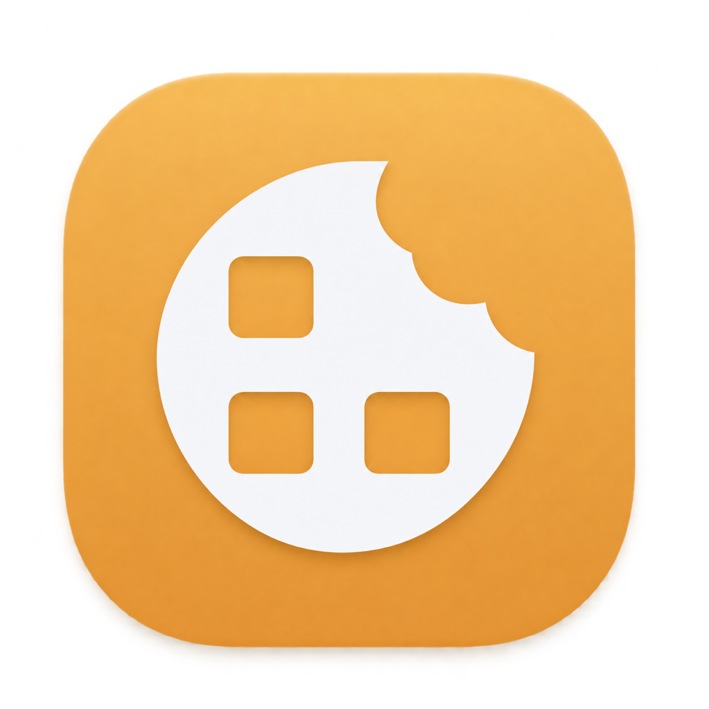
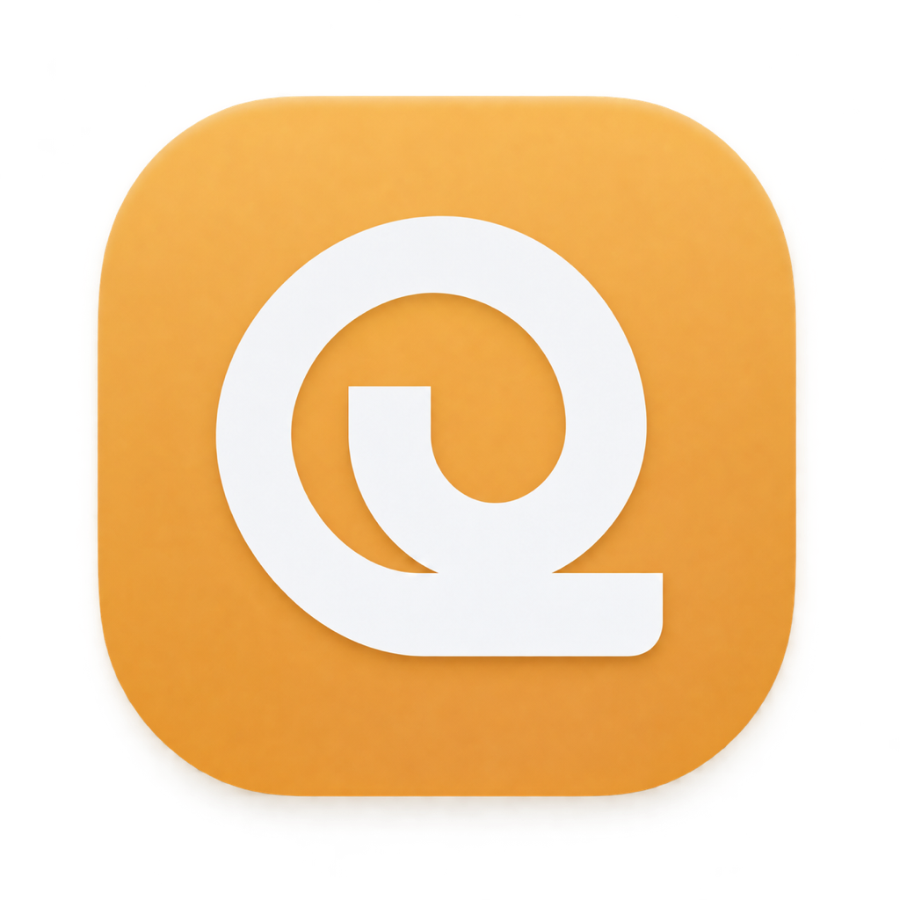

# Waffle logo concepts

Six different forms on the same honey tile. Each icon is a 1024 × 1024 PNG with transparency outside its squircle. Each companion SVG is a flat, one-colour mark using `currentColor` on a `0 0 100 100` viewBox, with no tile, embedded raster or font dependency.

| App icon | Idea and feeling | Why it reads at 16px | Files |
| --- | --- | --- | --- |
|  | **1. Short stack** Three waffle layers and one generous pocket turn a shared breakfast into a sociable, steady little stack. | One large opening and two broad layer bands preserve the stack silhouette. | [PNG](1-short-stack.png) · [SVG mark](1-short-stack-mark.svg) |
|  | **2. Waffle weave** A folded waffle strip forms a chunky W with two recessed pockets, giving the name a confident, playful initial. | The deep W valleys carry the identity even when the two pockets become tiny. | [PNG](2-waffle-weave.png) · [SVG mark](2-waffle-weave-mark.svg) |
|  | **3. Foldover** A waffle folded like a taco wraps three open pockets in a broad rim, making the mark feel warm and tucked in. | A single curved outline, three separated openings and a heavy base avoid a fine grid. | [PNG](3-foldover.png) · [SVG mark](3-foldover-mark.svg) |
|  | **4. First bite** A round waffle with a greedy bite missing brings a cheeky, hungry attitude without adding a face. | The scalloped bite breaks the round silhouette, while three oversized pockets stay separate. | [PNG](4-first-bite.png) · [SVG mark](4-first-bite-mark.svg) |
|  | **5. Waffle wings** Four pocketed waffle quarters lift into wings, giving a familiar breakfast shape a light, outgoing character. | Four broad lobes and a narrow waist remain legible before the pocket details register. | [PNG](5-waffle-wings.png) · [SVG mark](5-waffle-wings-mark.svg) |
|  | **6. Roll call** A curled waffle wafer ends in a broad tail and quietly recalls an @ sign, pairing a relaxed pastry shape with conversation. | One thick continuous coil and its square-cut inner end survive without small decorative details. | [PNG](6-roll-call.png) · [SVG mark](6-roll-call-mark.svg) |

The SVGs are the production geometry. The generated PNGs show that geometry on a softly shaded app tile. Flat marks were inspected at 16px and 32px; their silhouettes carry the identity when the smallest recesses soften. Use honey `#EFA831` on `#17181A`, or deeper gold `#BF7D06` on `#F8F9FB`. The icon treatment uses warm white on honey.

Image generation prompts

Generated with the built-in image generation tool, one call per concept, using a raster rendering of that concept's SVG as the silhouette reference. Outputs were resized to exactly 1024 × 1024 without changing their artwork.

The common prompt below was followed by each concept's addition.

### Common prompt

Use case: logo-brand. Deliver ONE 1024x1024 PNG app icon for Waffle, a playful warm desktop chat app. Use the supplied black-on-paper image ONLY as exact vector silhouette reference: preserve its contours, openings, proportions and orientation; recolor the black mark to solid warm white #F8F9FB and discard its paper background. Center the mark on one front-facing macOS superellipse squircle tile, tile bounds approximately x=100..924 y=100..924 on a 1024x1024 canvas. Tile has a very slight honey-gold vertical gradient from #F6BD54 at top to #EFA831 at bottom, very restrained soft edge highlight. Mark width about 56% of tile, visually centered with generous padding. Mark is completely flat, opaque, one color with just a tiny soft contact shadow. Transparent canvas outside tile with a gentle cast shadow immediately beneath tile. No perspective, no surrounding UI, no labels, no lettering, no food texture, no realistic baking, no butter or syrup, no bevelled or puffy 3D mark, no facial features, no extra holes, no additional decoration. Match the SVG silhouette exactly.

### Short stack

Concept 1, Short stack: three flat lozenge waffle layers, one large diamond pocket in the top layer. Keep exactly those two lower layer bands and the single top opening. The stack suggests friends gathering for breakfast.

### Waffle weave

Concept 2, Waffle weave: an upright bold letter W made as a folded waffle strip, two small broad rectangular waffle pockets recessed into its outer arms. Preserve the rounded lower valleys and middle peak. Exactly two holes, both contained completely inside the arms. The W is a food-led initial, confident and friendly.

### Foldover

Concept 3, Foldover: a folded semicircular waffle taco, leaning slightly left, with a broad solid folded rim at its diagonal base. Exactly three radial openings: a large central rectangular pocket and two flanking wedge pockets. Preserve all three openings, asymmetric curved outline and angled lower edge. A warm, tucked-in feeling. It is a folded waffle, never a face or a helmet.

### First bite

Concept 4, First bite: a round waffle with a bold three-scallop bite removed from its upper-right edge, exactly three large rounded-square waffle pockets left in an L arrangement. Keep the round outline and generous bite. Cheeky, hungry, instantly food-like. Preserve the silhouette exactly; no crumb details.

### Waffle wings

Concept 5, Waffle wings: four soft rounded waffle quarters lifted into a butterfly silhouette, two large upper wings and two small lower wings, exactly one generous four-sided pocket inside each wing. One joined flat form. Preserve the broad upper wings, small lower wings and narrow center. Light, social and ready to take flight. No insect head, no antennae, no eyes or face.

### Roll call

Concept 6, Roll call: a broad curled wafer waffle ribbon, a single continuous round coil whose flat outer tail extends right along its bottom edge. The squared inner cut end makes a square-bottomed inner pocket; do not replace it with a circular dot. It gently recalls an @ sign without an actual letter or text. Warm, conversational and easygoing. Match the open coil and broad bottom tail precisely.

